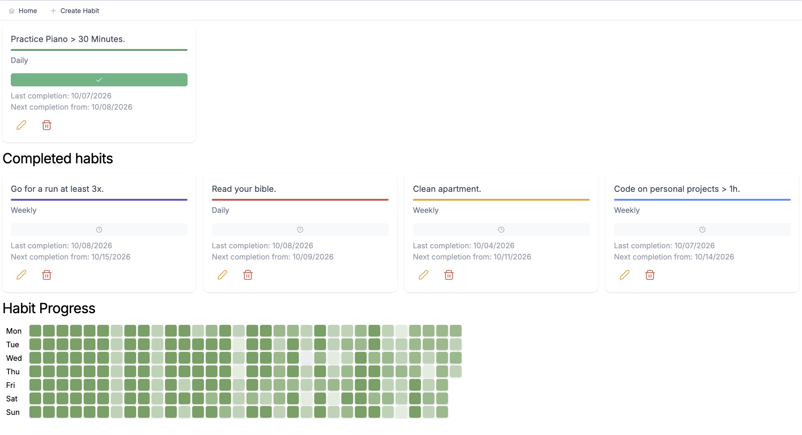

# habit-tracker
This is a simple habit tracker with a habit completion heatmap written using Vue 3.



## Usage
The project requires a working `npm` and Vue setup with ´vite´. To run it in dev mode run:

```sh
npm install
just
```

For demonstration purposes it uses a fixed list of habits found in `src/assets/example_habits.json`.
The local storage is overwritten on every startup with this list.
To disable this behavior, remove the `seedExampleData()` call from `src/main.js`.
